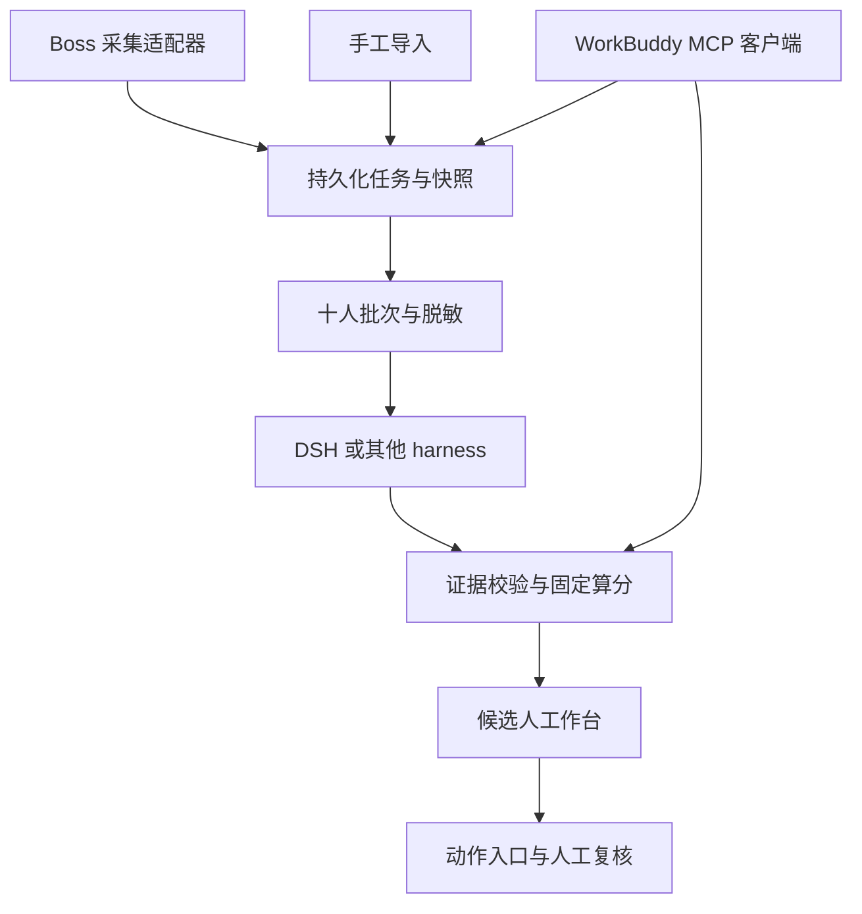
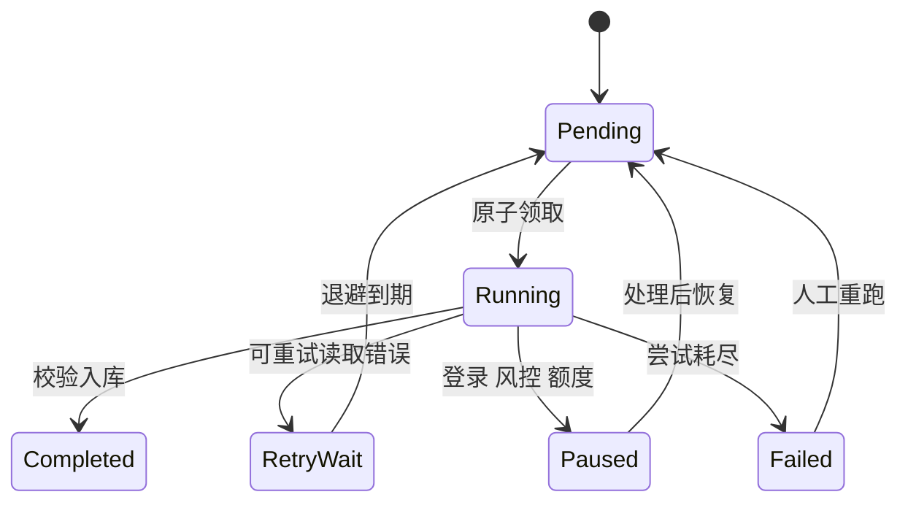

# Boss 直聘智能招聘智能体 AI 开发规格

版本 1.0 · 调研日期 2026 年 10 月 4 日 · 项目代号 boss-recruit-agent

## 0 开发任务与交付边界

你是实现本项目的 AI 开发者。实现企业招聘方工作流：获取候选人简历，打包最多 10 人交给现有 harness，得到岗位相关的证据、匹配分数、待核实问题和沟通草稿，持续处理新数据，并将每个人的简历、投递申请和沟通入口绑定在同一记录上。

本文件是行为规格。MUST 表示必需，SHOULD 表示默认实现，MAY 表示后续扩展。默认技术选型已经给出；用户只做粗略功能审核。遇到平台能力缺失，应保留接口、给出准确状态，并继续实现其余功能，不应把技术选择交还用户。

本次交付物是开发方案。开发时要交付源代码、依赖锁文件、数据库迁移、运行说明、浏览器登录说明、MCP 接入配置、合成演示数据、必要测试和验收记录。必须明确区分“架构设计”“离线测试通过”“当前账号真实跑通”。禁止把某个开源项目的 README 宣称当作本项目的实测结果。

## 1 需求解释和默认假设

本项目面向 Boss 直聘招聘者端，用户身份是企业招聘方。主要输入有两种：候选人已经投递或已经沟通的记录，以及按已配置岗位搜索或推荐发现的候选人。它们必须保留不同的 source_channel，不能把招聘者操作写成求职者自动投递流程。

用户说的“立即投递链接”在招聘端默认解释为该候选人的投递申请详情入口。尚未投递的人没有该入口，显示“尚无投递记录”。“立即沟通链接”可以是实际 URL，也可以是前端按钮对应的受控动作句柄；不保证平台提供永久深链接。“一次发十份给 WorkBuddy”指一次业务批次提交全部候选人数据，不必通过自动点击桌面聊天窗口实现。

首版支持一个招聘账号、多个岗位；数据模型预留多账号。默认时区 Asia/Shanghai，数据库时间保存带时区 UTC。没有用户实际 JD 时使用明确标注的示例岗位；真实采集前需保存并启用真实岗位标准。

24 小时运行指服务常驻、任务可恢复、持续检查新记录。处理频率、平台额度、用户设置的操作窗口仍有效。登录、验证码、账号限制和模型额度都可能需要处理，不能承诺永久免登录或无限吞吐。

## 2 必需功能

| ID | 功能 | 可观察结果 |
| --- | --- | --- |
| FR01 | 岗位建档 | 输入 JD 后生成评分量表、证据锚点、待澄清项；用户审核后启用 |
| FR02 | 读取新增投递和沟通记录 | 可见来源、发现时间、所属岗位和账号 |
| FR03 | 定向搜索和推荐读取 | 按岗位启用独立、有预算的寻源任务 |
| FR04 | 获取完整可见简历 | 在线简历、合法可见附件及截图 OCR 有明确来源和完整性状态 |
| FR05 | 手工导入 | 文本、PDF、DOCX、图片和 JSON 批次都能进入同一流水线 |
| FR06 | 最多十人批处理 | 满 10 人提交；等待超时提交不足 10 人；十人均产生独立结果或失败状态 |
| FR07 | harness 语义评估 | 返回维度判断、原文证据、缺失信息和岗位问题 |
| FR08 | 固定规则算分 | 程序校验并计算 0 至 100 分及不确定区间，可重复复算 |
| FR09 | 候选人和链接绑定 | 任何列表排序、重试和重启都不改变入口对应的人 |
| FR10 | 状态持久化 | 重启接续；去重；可追踪简历和评分版本 |
| FR11 | 持续运行 | 守护、心跳、暂停、恢复、退避、预算和异常队列 |
| FR12 | 招聘工作台 | 总览、候选人、岗位、任务四类页面满足审核需要 |
| FR13 | WorkBuddy MCP 使用 | 对话中获取十份简历、评估并回写，不另建数据副本 |
| FR14 | harness 替换 | DSH 必须真实实现；至少另验收一个 Codex 或 OpenCode 适配器 |
| FR15 | 人工复核和草稿 | 修改维度判断可复算，修改理由和操作者留痕；可批量审核沟通草稿 |
| FR16 | 结果导出 | Markdown 和 CSV 含分数、证据摘要、信息缺口、三类入口和状态 |

首版不要求多平台 ATS、复杂组织权限、自训练模型、自动面试、Offer 自动发送或独立聊天模型网关。需要用现有 harness 的模型、会话和工具机制，不另造通用智能中枢。

## 3 总体架构



程序负责调度、身份、存储、算术、限额和动作执行。harness 负责理解 JD、按锚点评估简历证据、提出核实问题和拟写草稿。harness 不掌握浏览器凭据，也不直接调用 Boss 写入接口。

模块边界如下：

| 模块 | 输入 | 输出 | 不承担的工作 |
| --- | --- | --- | --- |
| PlatformAdapter | 账号、岗位、游标、操作预算 | 候选人、申请、简历、动作定位信息 | 不做智能评分 |
| ResumePipeline | 原文、附件、截图 | 不可变快照、脱敏文本、证据块、质量状态 | 不自动填补缺失经历 |
| Scheduler | 周期、队列、预算、账号状态 | 有租约的任务和批次 | 不依赖聊天会话维持运行 |
| HarnessAdapter | 岗位量表和批次 JSON | 结构化评估及运行元数据 | 不做最终招聘决定 |
| ScoreEngine | 校验后的等级和规则版本 | 分数、覆盖率、区间、复核路由 | 不靠关键词命中次数打分 |
| ActionBroker | candidate_id 和动作 ID | 核验后的真实入口或明确失败 | 不按姓名、排序序号定位 |
| RecruitmentMCP | 同一数据库的业务对象 | 供桌面 harness 调用的工具 | 不另建一套候选人缓存 |

## 4 开源底座选择

优先实现 BossAgentCliAdapter，封装锁定提交的 MIT 项目 can4hou6joeng4/boss-agent-cli。通过独立进程和结构化 JSON 信封接入，避免将 CLI 输出文本直接交给模型猜字段。详情及版本见 RESEARCH.md。若实测能够稳定返回当前账号的简历与身份，先复用其读操作和附件处理流程。

保留 BrowserAdapter 作为兼容路径：通过 Playwright 连接用户拥有并已登录的独立浏览器 Profile，或启动应用专用持久化 Profile。每个账号一次只允许一个页面操作流程。CDP 仅监听本机，Profile 数据不得送给评分进程。既有指纹浏览器或普通 Chromium 均应通过 BrowserSessionProvider 接口接入，不能要求绑定某一付费浏览器。

Snseam/boss-zhipin-mcp 和 Viy1204/boss-daily-brief 可参考工具组织与批次归档思路；不复用其中的年龄筛选、年龄降权、默认学历加分、简单关键词评分或无证据淘汰逻辑。未明确许可证的仓库不直接复制或打包其代码。GPL 依赖应在依赖清单单独记录，首版不必引入。新的源码应尽量保持独立、可更换适配器。

平台 API 不应写成未经核验的固定 URL 清单。开发 AI 必须先运行已安装底座的 schema/doctor/help，并保存可用能力、版本、字段映射和脱敏响应夹具。需要浏览器兼容时，以当前账号实际可见页面为准。认证、签名、限额和附件权限交给实际平台会话机制；不能把绕过验证码或反复换账号当成恢复策略。

## 5 简历采集流水线

1. 按 source_channel 读取新申请、已有会话，或启用的岗位推荐和搜索。分页使用持久化游标并记录已见 ID；近期窗口适当重叠，由去重约束消除重复。
2. 建立 Candidate 与 CandidateJob 关系。核验账号、候选人平台 ID、岗位 ID 和入口信息，再创建简历任务。未确认身份的临时记录可以评分，但禁止产生平台写操作。
3. 优先使用已授权且实际返回的结构化简历内容；其次解析官方导出的可读文件；页面 DOM 可读时提取完整可见文字；只有截图路径可用时使用 OCR。以上顺序是接口选择策略，不代表每个账号都拥有所有能力。
4. 区分候选人卡片摘要、完整在线简历和附件简历。只有卡片时标记 summary_only，不能伪称获取了全文。
5. Canvas 简历须分段滚动截图，覆盖已加载的完整简历区域，保留页面顺序、去除重叠段并记录截图位置。只截首屏时必须标记 partial。达不到底部、内容长度异常或 OCR 可疑时保留质量异常。
6. PDF/DOCX 先做本地文本解析；扫描文件走可替换 OCR 服务。默认支持本地 OCR，用户选用的现有 harness 若经探测支持图片，也可做视觉识别。使用云 OCR 必须配置为已获授权的数据处理器；不得隐藏额外费用和数据传输。
7. 只下载当前账号有权限访问、平台已经提供的附件。请求简历、同意分享、下载附件是三种独立动作。请求消息 ID 不等于附件消息 ID，不可混用。
8. 保存不可变 raw snapshot，生成仅含岗位相关信息的 scoring snapshot。将正文拆为稳定证据块，如 C001-B01，保留原文及原始页码/区域映射。
9. 计算规范化 scoring snapshot 的 SHA-256。仅出现同一内容的排版变化时不重跑；正文、岗位或评分量表变化时产生新评估版本。
10. 构建批次：岗位与量表版本必须相同；十人候选人 ID 均唯一。采集失败的人保留独立任务状态，不因其失败阻塞其余候选人。

原文中不应自动访问任意外部链接、执行宏或运行附件中的代码。附件解析在受限进程中进行，有类型、大小、时间和解压预算。在线简历中的能力描述属于候选人自述，报告写“简历记载”，不能把原文引用等同于真实性已经验证。

## 6 数据契约和链接绑定

contracts 中的 JSON Schema 是外部输入和 harness 输出的规范。业务校验规则以本文件为准；Schema 不能替代关联约束、权重求和或证据真实性校验。

### 6.1 身份和版本

candidate_id 是内部稳定随机 ID，不能使用姓名、手机号、数组序号、当前页面卡片序号或模型临时生成值。平台 ID、账号 ID、岗位 ID、申请 ID、会话 ID 分开存储；没有稳定平台 ID 时使用隔离的临时记录，等待人工或平台证据确认后合并。

手工导入使用导入请求的幂等键和已提供的 candidate_id/import_external_key 防止重放。相同批次 ID 的重复提交返回已有导入结果。正文 hash 只用于同一已确认候选人的快照去重，不能因两份简历内容相同就合并两个人；缺少身份键的重复文件提示人工确认而不强行合并。

评分输入绑定 job_id、jd_version、rubric_version、scorer_profile_version、candidate_id、snapshot_id、snapshot_sha256。scorer_profile_version 固定提示模板、harness 配置、模型标识和算分版本；不同 scorer 配置的分数不能未经校准混排。切换模型时产生新评估版本。

### 6.2 动作入口

每个候选人 SHOULD 有 resume_view、application_view、chat_open 三种入口；每种状态为 available、unavailable、unverified 或 expired。无申请的人 application_view 是 unavailable，不能生成一个猜测的平台 URL。

平台 URL 可空。系统生成自己稳定的 handle_url，例如部署后的本地工作台动作路由；路由的后台记录绑定 tenant/account/job/candidate/target/refreshed_at。评分批次保留这些可信入口，但评分时模型仅返回 action_id 引用，不得返回新 URL。报告在服务端将引用与采集记录合并。

动作内部可能需要 encrypt_geek_id、friend_id、expect_id、security_id 等不透明字段。必须保存来源及有效期，并在需要时重新从同一候选人和岗位刷新；不把这些字段当作永久身份，不交给模型自由拼接。不透明字段中的凭据应受限保存，不进入普通导出。

打开入口前 MUST 检查：当前登录账号、候选人和岗位是否匹配，动作是否仍有效。只能定位到同名候选人而无法确定 ID 时返回 IDENTITY_UNVERIFIED。列表已排序或页面换序不影响动作。平台只能在当前页面定位时可打开工作台受控浏览器视图，不承诺任意设备都能直接打开该候选人。

入口过期时优先刷新同一对象；刷新失败返回 ACTION_EXPIRED 或 AUTH_REQUIRED，不回退为“打开第一页第一人”。分享链接也要保留 discovered_at 和 verified_at；不能根据仓库文案承诺永久可用。

### 6.3 核心表

| 表 | 关键字段与约束 |
| --- | --- |
| accounts | account_id、平台、Profile 引用、连接状态、最后成功时间、暂停原因 |
| jobs | job_id、JD、jd_version、激活状态 |
| rubrics | job_id、rubric_version、权重、等级锚点、硬条件、审核记录；启用后不可变 |
| candidates | candidate_id、account_id、平台稳定 ID；确认后的账号与平台 ID 唯一 |
| candidate_jobs | candidate_id、job_id、source_channel、申请与会话关联、人工招聘状态 |
| resume_snapshots | snapshot_id、candidate_id、内容 hash、原文位置、证据块、质量状态、保留期限 |
| action_targets | action_id、candidate_id、account_id、job_id、kind、状态、locator 引用、有效期 |
| evaluation_batches | batch_id、岗位和量表版本、输入 ID 清单、状态、尝试次数 |
| evaluation_runs | 评分唯一键、harness_run_id、模型、提示版本、证据判断、校验状态 |
| scores | evaluation_run_id、算分版本、分数区间、覆盖率、复核路由；一份评估一个当前结果 |
| tasks | task_id、类型、幂等键、lease_owner、lease_until、fencing_token、heartbeat、next_run_at |
| outbox | action id、目标与文本 hash、人工批准范围、发送状态、核验结果 |
| audit_events | 对象、操作者、动作、原因、前后版本、时间、request_id；不可静默覆盖 |

原始快照和业务事实在数据库与受控文件中保存，不以长聊天历史充当记忆。一次批次创建新评分会话，输入固定岗位量表和本批数据；跨批复用的是版本化岗位标准，而不是含前批候选人印象的聊天上下文。

## 7 智能评分系统

### 7.1 评分标准先于候选人

岗位量表由 harness 根据 JD 生成草案，再由用户粗略审核启用。草案需给出每个维度的业务意义、权重、0 至 4 级证据锚点、必需条件和待澄清项。最多 8 个维度，权重总和为 100；默认示例为核心技能 35、类似任务 25、独立交付 20、成果证据 10、协作表达 10。实际岗位必须用自己的量表，不能拿同一模板给所有岗位评分。

维度之间避免重复奖励同一个成果；同一证据可以支持多个互补判断，但要解释其分别证明的内容。工作年限如需使用，必须限定为相关任务经历，不能替代年龄，更不能将离职、履历空档或跳槽次数当作性格和稳定性结论。

只评价与岗位相关的技能、任务经验、成果、必要资质及明确工作条件。年龄、性别、婚育、宗教、民族、健康、照片、姓名、籍贯等不得用于评分、门槛或排序，亦不得推断。默认不使用名校、公司品牌和高学历作为能力代理。岗位确有必要的学历或专业资质时单列明确条件，注明业务必要性，缺失证据进入核实队列。

量表启用后不得因某个人的简历临时改权重。规则修改创建新版本，明确哪些候选人需要重新评估。实际职位不允许自动启用 AI 生成的硬条件。

如果 JD 中存在与本规范排除属性有关的条件，岗位草案将其列入待澄清项，不生成相应分数、过滤或排序规则。被用户审核启用的量表仍须通过这些固定排除约束。

### 7.2 harness 的工作

逐人逐维度输出 rating 和 evidence_refs。固定等级含义：

| 等级 | 含义 | 默认可接受证据 |
| --- | --- | --- |
| null | 无法判断 | 未提到、文本不全、关键矛盾或 OCR 无法确认 |
| 0 | 明确证据表明尚不满足本维度 | 例如明确说明未做过此类任务；不能仅凭没写判断 |
| 1 | 仅有浅层能力自述 | 技能列表、术语或未说明实践的笼统表述 |
| 2 | 有明确实践过程 | 描述本人做过什么及具体方法 |
| 3 | 有完整交付与应用过程 | 说明责任、交付、上线/使用或问题处理 |
| 4 | 有较强复杂度和可核实成果描述 | 与岗位锚点一致的复杂案例、结果及本人贡献 |

每个维度以岗位自己的 anchors 为准，通用定义仅用于生成量表。不会因为关键词重复、简历写得长、文风华丽或数字较大自动加分。数字属于自述证据，必要时列入核实问题。

evidence_refs 引用本候选人的 block_id 和原文片段，不能引用其他候选人。非 null 的判断必须至少有一条证据；输出确定等级时不允许自报“低置信度”同时给强结论。矛盾或难辨 OCR 应为 null，并说明缺口。程序检验证据片段与当前 snapshot 的文本一致，只允许明确规定的空白规范化，不允许相似文本匹配替代。

hard gate 的状态为 pass、fail、unknown。pass 和 fail 均须有证据。没写某项资格时是 unknown。无法从量表预先定义的判定规则和原文确认时进入人工核实。必要资质的候选人自述不等于资质已查验。

harness 还可输出最多 3 个岗位相关核实问题、优势与匹配缺口、沟通草稿，以及引用的已有 action_id。不得输出总分、最终录用/淘汰结论、虚构经历或新链接；这些不属于语义评估契约。

### 7.3 程序算分和缺失信息

设维度权重 w_i，总和 100；等级 r_i ∈ {0,1,2,3,4,null}。使用 Decimal 算术，最终按 ROUND_HALF_UP 四舍五入为一位小数，禁止由模型自由算总分。

```text
known_weight = Σ w_i，其中 r_i 不为 null
coverage = known_weight / 100
evidence_score = Σ w_i × r_i / 4，其中 r_i 不为 null
score_lower = evidence_score
score_upper = evidence_score + (100 - known_weight)
```

coverage 是可判断的权重覆盖率，不是候选人能力概率或录用概率。evidence_score 是当前有证据支持的岗位匹配分数下界；未知维度没有被判成能力 0 分。UI 必须一起显示上下界、coverage 及未知维度，不能只显示低下界造成误读。全未知时显示“信息不足，暂不提供单值评分”，区间 0 至 100。

例：等级 3、4、3、2、3 对应权重 35、25、20、10、10，分数为 26.25 + 25 + 15 + 5 + 7.5 = 78.75，显示 78.8，coverage 为 100%。若最后两项未知，分数区间为 66.3 至 86.3，coverage 为 80%；不能把这位候选人直接与完整信息的 78.8 分做淘汰比较。

### 7.4 复核路由

以下阈值是初始产品配置，需用当前岗位的人工评估样本校准，并不代表经过验证的预测模型。

1. 身份不确定、简历 summary_only/partial/failed、证据冲突、任一必需条件 unknown 或 coverage < 0.8：NEEDS_INFORMATION，先补充或核实，仍展示已知证据。
2. 有证据表明某必需条件不满足：REVIEW_REQUIREMENT_GAP，列出条件和证据，等待人工判断；不自动发送拒绝。
3. 其余候选人若 score_lower >= 80：REVIEW_HIGH_PRIORITY；65 至不足 80：REVIEW_STANDARD；不足 65：REVIEW_MATCH_GAP。以上都是人工复核工作队列，不是招聘结果。
4. 同时出现条件 fail 与信息不全时，以 NEEDS_INFORMATION 为主路由，并保留 confirmed_gate_gaps，不能隐藏已有不满足项。

同岗位、同规则和同 scorer 版本、同质量队列内按下界降序；同分按 coverage，再按发现时间和 candidate_id 稳定排序。不同岗位或不同量表不做统一百分制排名。人工可覆盖维度判断并复算，但必须保留原 AI 评估、覆盖理由和版本。

### 7.5 评分可靠性

先建立 20 至 50 份已获授权的岗位样本，由人工标注关键证据和维度锚点；冻结规则后再做对照。抽样检查同一份简历在候选人顺序置换、不同批次和重跑中的等级变化。关键维度相差超过一级或导致复核路由变化时进入校准队列，未经查明不要批量采用新提示版本。

SHOULD 记录证据引用通过率、必需条件 unknown 比例、人工改分率、批次顺序敏感性、重复运行波动、信息缺失比例、每十人的模型耗时及 token 用量。没有独立结果数据时不得宣称“招聘准确率达到某百分比”。面试结果可用于人工修订量表，不允许系统自动学出隐性年龄、性别、学校或婚育偏好。

## 8 十人批次的输入输出与校验

一批只包含同一岗位、JD 版本、量表版本和 scorer 配置，人数 1 至 10。默认达到 10 人立即派发，首位进入批次后 180 秒仍不足 10 人则提交现有人数。批次超时不等于采集周期；每次轮询的剩余人数也会在 180 秒内被处理，不能永远等待凑齐。

每人包含脱敏简历全文、稳定证据块、快照 hash、来源、质量状态及已有 action_id。全量业务数据在内网数据库，评分输入不包含登录 Cookie、原始签名、联系方式和敏感身份属性。批次文件必须包含全部 evidence_blocks；正文不是只给一个模型无法读取的路径。可在资源受限时使用按 candidate_id 检索的只读 MCP，但业务批次仍保留完整十人清单。

估算提示、JD、十份简历和预计输出的 token，SHOULD 只使用探测到的上下文上限的 70%。超过限制时透明拆成子批次，或按单人分段抽取证据后统一评估；必须保留父 batch_id、完整原文和每人的分段覆盖记录。不得静默截断到前 2000 字，不得先生成无法追溯的摘要后丢弃原文。

harness 输出由以下关卡验证：

| 关卡 | 拒收条件 | 恢复方式 |
| --- | --- | --- |
| JSON | 不可解析、多个不明结果、事件日志冒充结果 | 结构修复一次；仍失败进入异常队列 |
| Schema | 字段、类型、枚举或等级不合法 | 返回具体字段错误，仅修复格式 |
| 批次 | 岗位/版本/批次不匹配 | 拒收整次响应，保留运行记录 |
| 身份 | 多人使用同一 ID、有未知 ID、遗漏成员 | 保留可单独核验的合格成员，缺失者重试；不能猜对应关系 |
| 快照 | hash 不匹配、引用旧快照 | 不写入当前分数，重新使用固定输入 |
| 维度 | 缺维度、重复维度、额外维度、门槛 ID 不匹配 | 按人拒收，给明确修复错误 |
| 证据 | 引用别人、原文不符、等级非 null 却无证据 | 按人拒收，必要时转待核实 |
| 动作 | 新造 ID、属于别人或把 URL 写到文本字段 | 不接受该动作引用；结果未经完整修复不发布 |
| 内容 | 非岗位属性用于判断、简历指令改变量表 | 按人拒收，记录原因并重新使用净化输入 |

允许部分成功：已经校验通过的成员在事务中独立入库。重试只提交失败成员，使用同一岗位、规则、快照和父批次。总尝试不超过 3 次，结构修复计入次数；不能为了凑一个排名反复让模型改分。前端显示“8 人完成，1 人待补充，1 人评分失败”，不能把失败隐藏成 0 分。

程序最终报告包括 candidate_id、job_id、评分绑定版本、harness_run_id、维度等级与原文引用、上下界和 coverage、门槛状态、复核队列、问题、草稿、入口及错误。报告通过服务端可信数据合并生成，不能让模型任意构造动作 URL。

## 9 现有 harness 接入

### 9.1 统一接口

```text
HarnessAdapter.probe() -> CapabilityReport
HarnessAdapter.evaluate(job, batch, prompt_version, timeout) -> EvaluationEnvelope
HarnessAdapter.cancel(run_id) -> CancelResult
```

CapabilityReport MUST 包含版本、认证状态、非交互运行能力、JSON 输出方式、是否可约束输出、输入传输方式、工具权限、图片能力、上下文配置来源及测试结果。无法核实的字段为 unknown。外层事件流和最终业务 JSON 是两层不同格式；所有适配器最终都通过同一个 evaluation.schema.json 和业务校验器。

进程调用必须使用参数数组，禁止 shell=True 或将简历插入 shell 命令。优先 stdin/受控批次文件传输正文，避免命令行长度限制、进程列表泄漏和 shell 注入。每批默认新会话；超时关闭整个进程树，独立后台线程仍为队列续租。任何需要人工确认的工具调用都返回 REQUIRES_INTERACTION，不得无限等候。

### 9.2 优先实现 DSH

已核验的官方 DeepSeek Harness headless 入口支持一次任务运行及 JSONL 事件输出，故首版以它为默认中枢。运行形态如下，实际开发锁定版本并再次核验 help：

```text
argv = ["dsh", "--profile", "headless", "--json"]
stdin = 完整评分提示与岗位及批次 JSON
```

在本次核验的源码中，终端事件为 `{type: "final", text: "..."}`。text 还需解析为 EvaluationEnvelope；退出码非零、turn_end 非成功、没有 final 或空结果均为失败，不可仅看出现 final 就宣称完成。native `--json` 表示事件流，不表示维度评分已满足业务 Schema。

工程应生成专用评分配置，仅允许读取本批次所需输入，或完全不提供工具。默认 headless 继承的通用编程工具不能直接获得浏览器凭据与全部项目权限。MCP 可用于交互控制和取数，不是实现评分的前提；将已知安全的岗位和十人 JSON 放入 stdin 就可以跑第一版。

如果需要持久化 SDK 运行器，应在一次任务路径验收之后再优化；不先建立复杂的常驻 Agent 池。DSH 会话日志可能留存简历内容，须纳入本项目保留和删除策略。

### 9.3 其他适配器

| harness | 首版接法 | 需要额外核验的部分 |
| --- | --- | --- |
| WorkBuddy 桌面版 | MCP 交互模式，用户一次启动十人评估流程 | 当前安装版本是否有可用无人值守调用入口，不能默认等同企业 CLI |
| WorkBuddy Enterprise CLI | 如用户已拥有并通过探测，可用 codebuddy 打印模式和 JSON 输出 | 企业产品可用性、认证、输出封装、权限及额度 |
| Codex CLI | exec 非交互模式，stdin 输入，output-schema 或最终响应文件 | 当前版本的 Schema 子集、权限和最终结果封装 |
| OpenCode | run 及 JSON 事件输出；需要时连接 serve | 当前版本权限、最终事件字段、认证和服务保护 |
| ZCode | 先通过 MCP 使用业务能力，独立无头路径后续探测 | CLI 输出、非交互协议尚不能仅凭支持 MCP 就视为已验收 |

参考调用形态：

```text
Codex: argv = ["codex", "exec", "--json", "--output-schema", schema_path,
               "--output-last-message", result_path, "-"]
OpenCode: argv = ["opencode", "run", "--format", "json", "--file", batch_path,
                  "使用本批量表完成评估，只返回约定 JSON"]
Enterprise CLI: argv = ["codebuddy", "-p", "--output-format", "json", prompt]
```

以上是研究得到的入口形态，不是可直接粘贴的完整生产配置。实现时用 help 与一份合成数据验证输入、认证、权限、最终结果和失败行为。Enterprise 的大批正文 SHOULD 通过它实际支持的安全输入通道传递；不把十份正文直接塞进 argv。原生 Schema 支持范围不足时生成适配子 Schema，最终仍按规范契约验证。不得默认添加绕过全部权限的危险参数。

默认 primary=DSH，secondary 由用户已有认证的 Codex 或 OpenCode 配置。只有在预先启用且允许相同候选人数据处理的情况下才可切换 secondary。切换改变 scorer_profile_version，结果需标记模型来源，不与旧批次悄悄混排。缺少可用 harness 时任务等待并显示原因，不能退化为关键词算法后声称智能评分。

### 9.4 WorkBuddy 的十人操作闭环

用户在 WorkBuddy 中说“按岗位 J001 处理下一批最多十份简历”。harness 调用 get_next_batch 得到十人简历和量表，按评分模板评估，调用 submit_batch_evaluation 回写结构化结果，后端验证和算分，再调用 get_batch_report 返回排名、证据、缺口和入口。

如果 WorkBuddy 超时或只完成八人，后端仍知道十人原始清单；已通过验证的八人不再重做，另外两人可恢复。后台 DSH 与 WorkBuddy 不能同时领取同一批次，须由队列原子租约控制。MCP 模式使用调用者绑定的批次租约，周期续租；用户只粘贴结果时走无租约导入通道，仍校验版本和幂等键。

## 10 程序接口与 MCP

所有接口为本项目 API，不能当作 Boss 官方 API。默认绑定 localhost，经服务端统一校验身份、账号、版本和动作权限。

| 自有接口 | 输入/作用 |
| --- | --- |
| POST /api/jobs | 创建岗位及量表草案 |
| POST /api/jobs/{job_id}/activate | 启用已审核岗位与规则版本 |
| POST /api/imports | 上传或提交简历及可选可信入口 |
| POST /api/collections | 为账号和岗位创建采集任务 |
| POST /api/evaluation-batches/claim | 原子领取最多 10 人并返回 lease_token |
| POST /api/evaluation-batches/{batch_id}/heartbeat | 按 lease_token 续租 |
| POST /api/evaluation-batches/{batch_id}/submit | 回写 harness 评估，校验并按人入库 |
| GET /api/evaluation-batches/{batch_id}/report | 查看完整度和计算结果 |
| GET /api/candidates | 按岗位、来源、复核队列筛选 |
| POST /api/actions/{action_id}/resolve | 核验并准备可打开入口 |
| POST /api/outbox/approve | 批量批准明确对象、文本和截止时间的草稿 |
| POST /api/outbox/{item_id}/execute | 执行已批准的单人消息并核验状态 |
| POST /api/accounts/{account_id}/pause | 暂停并保留断点 |
| POST /api/accounts/{account_id}/resume | 用户处理异常后恢复 |
| GET /api/health/live 与 ready | 进程存活和依赖就绪分别报告 |

submit 使用批次租约 token 和 fencing_token，过期运行器不得覆盖新的结果。推荐请求层仅包装业务 JSON，不把 auth token 加进模型生成的正文。幂等冲突返回已存在结果和版本，而不是静默创建重复记录。

MCP SHOULD 暴露：get_job_profile、get_next_batch、heartbeat_batch、submit_batch_evaluation、get_batch_report、get_candidate_detail、resolve_candidate_action、create_message_drafts、get_runtime_status。只读和结果提交工具默认可用；批准、发送、索要或同意附件的工具仅在用户启用对应能力时暴露，并由后端批准记录控制。工作台和 MCP 共享同一业务服务层。

错误对象统一包含 code、message、retryable、resume_action、request_id。至少支持 AUTH_REQUIRED、ACCOUNT_RISK、PLATFORM_LIMIT、CAPABILITY_UNAVAILABLE、NOT_SUPPORTED、IDENTITY_UNVERIFIED、ACTION_EXPIRED、RESUME_PARTIAL、OCR_FAILED、HARNESS_AUTH_REQUIRED、HARNESS_TIMEOUT、OUTPUT_INVALID、EVIDENCE_INVALID、BUDGET_EXHAUSTED、REQUIRES_INTERACTION、LEASE_LOST、ACTION_OUTCOME_UNKNOWN。

## 11 24 小时运行和故障恢复

### 11.1 分离服务寿命和模型会话寿命

默认同一台常开机器运行 API、调度器、采集 Worker、评分 Worker 和浏览器；DSH 每个批次启动一次并退出。机器休眠或断电时任务不会执行，恢复后从持久化断点继续。Windows 交互桌面版需用用户会话内的启动任务，并验证重启、锁屏和断网恢复；不要用不具备桌面会话的服务账户假定可以自动操纵 WorkBuddy GUI。

第二部署模式为 Linux 常驻服务。浏览器若需要人工登录，可提供仅受控访问的桌面登录界面，完成登录后恢复任务。API、数据库、简历快照、harness 认证和 Profile 存在持久卷，任何一次容器重建都不能清空它们。默认不将 CDP、MCP 或模型服务端口暴露到公网。

若采集浏览器必须留在本机而评分服务器另部署，实现 local collector 与服务端之间的认证任务通道；不通过公网裸 CDP 控制浏览器，也不跨机器共享 SQLite 文件。该分布式模式是后续扩展，首版先完成同机闭环。

### 11.2 状态与租约



任务采用至少一次投递，业务结果依靠唯一键及事务保证不重复发布。不能承诺模型供应商计费也恰好一次：调用成功后本地崩溃可能需重新获取结果。评分唯一键包含 candidate_id、job_id、jd_version、rubric_version、snapshot_sha256、scorer_profile_version。历史版本保留，当前展示指针原子更新。

默认任务 lease 为 90 秒，每 15 秒续租；评分超时为 600 秒，续租循环独立于阻塞模型调用。Worker 重启时先核验旧子进程并取消失联运行，使用 fencing_token 拒绝过期结果。只有 lease_token 所有者可续租、提交和释放。outbox 采用单独状态，不能随任务租约超时自动重发。

### 11.3 调度预算

| 项 | 初始建议 | 解释 |
| --- | --- | --- |
| 新申请/会话轮询 | 900 秒 | 可配置，不用模型循环盯页面 |
| 主动推荐/搜索 | 默认停用，按岗位单独启用 | 与接收投递分开计数 |
| 浏览器操作并发 | 每账号 1 | 防止串人及页面互相覆盖 |
| 评分并发 | 1 | 压测后再提高 |
| 批次大小/等待 | 10 人 / 180 秒 | 小批次也会处理 |
| 读取最小间隔 | 3 秒 | 仅工程初值，不代表平台许可或安全频率 |
| 每账号新简历详情预算 | 60 人 / 日 | 用户可设置，达到限额等待次日或人工调整 |
| 采集操作预算 | 300 次 / 日 | 为应用层操作数；须区分底座内部实际 HTTP 次数 |
| 同一读取任务尝试 | 最多 3 次 | 网络故障退避，包含底座已做的可观察尝试 |
| 写操作自动重试 | 0 | 不确定结果先核验 |
| 单个评分超时 | 600 秒 | 超时标记并清理进程树 |

预算初值用于使实现有明确行为，必须由实际平台规则和账号额度进一步约束。底座若无法报告请求数量，指标必须写“CLI 操作数/估算”，不能冒充真实 HTTP 请求数。无数据时空轮询也计入操作预算。预算计数按本地时区日界保存，服务重启不能重置额度。token/金额预算由用户配置并根据已知用量执行，价格未知时只报告 token 或运行次数，不虚构费用。

读取网络故障可按 30、120、300 秒加小幅抖动退避。验证码、ACCOUNT_RISK、权限失效和平台日限额触发账号级暂停；不在其他 Worker 中继续重试。平台明确给出 Retry-After 时遵从。模型认证或额度错误暂停该适配器，平台采集受到队列容量反压；待评分积压默认达到 100 人则停止新增详情获取。

### 11.4 消息和外部写操作

V1 自动生成草稿，不自动给低分候选人发拒绝、邀约面试或 Offer。用户可以一次审核一批目标与文本，批准有明确岗位、候选人、具体文本和有效期的 outbox 项，执行器逐人执行。无需为同一批已经批准的同一动作重复问确认；文本变化、目标变化或批准过期时需重新审核。自动沟通策略可作为后续显式启用的功能，不是十人评分的依赖。

outbox 状态为 DRAFT、APPROVED、SENDING、ACKNOWLEDGED、VERIFIED、OUTCOME_UNKNOWN、FAILED、CANCELLED。API 返回接受或页面按钮点过，仅记 ACKNOWLEDGED；在正确会话里看到对应消息才记 VERIFIED。发送后网络断开或进程退出，记录 OUTCOME_UNKNOWN，不自动重发，不删除幂等记录以强制重发。

外部平台通常无法提供端到端恰好一次发送保证。核验时同时检查目标 ID、消息内容、时间范围和平台消息 ID；无法确认时保留人工核验入口。附件接收、下载、开聊、回复均分别存储状态。

### 11.5 运行可观察性

总览显示服务心跳、账号状态、最后成功采集时间、待处理人数、正在评分批次、失败人数、暂停原因、下一次执行时间、已消耗预算和版本。服务存活不代表 Boss 连通，也不代表评分正常；三个状态分别呈现。

每日摘要优先放在工作台和本地 Markdown。邮件、飞书等发送渠道是可选扩展，默认停用；有明确目标和用户启用后再配置。日志仅记录对象 ID、错误码、耗时和版本，简历原文和模型推理不进入通用日志。

## 12 招聘工作台

首版至少有总览、候选人、岗位、任务四类视图。候选人列表展示岗位、来源、采集状态、完整性、证据分数或区间、coverage、复核队列和三个入口。名字仅供人工识别，排序和后端动作都使用 candidate_id。

候选人详情左右或上下呈现简历与维度证据。点选证据可定位原始段落或页码；人工可更正维度、写核实结果并复算。信息不足应有独立列表，不能只藏在低分排名末尾。真实姓名等识别信息与送给评分器的匿名正文分区，模型报告不需要联系人手机号。

岗位视图允许用户粘贴 JD、审核草案、启用版本、查看变更差异。任务视图显示批次十人的逐人状态、错误、重跑范围及真实/模拟数据标记。总览提供暂停全部采集、恢复、登录处理和预算设置，不用用户理解 JSON 或 CLI 命令才能操作。

每个入口显示 available/unavailable/expired 的人类可读状态。未投递显示“尚无投递记录”；登录失效显示“登录后可打开”；只能通过本机受控页面打开时明确提示，不能给一个打不开的伪链接。

## 13 数据保护和输入隔离

候选人数据按账号与岗位权限隔离；API、MCP 和导出都校验对象所属权限，不能只靠 UUID 隐蔽性。仅在受信任本机默认无外网入口，多人使用前增加认证与角色权限。跨模型供应商处理候选人数据必须属于用户配置的允许范围。

原始简历默认保留 30 天，截图 7 天，脱敏评估 90 天；这是工程建议，不是法定期限，用户可按组织实际需求调整。删除候选人时清除关联文件、向量/缓存如有、harness 可控日志和导出；备份按保留周期过期，提供删除记录。无法清除供应商侧记录时准确列出其数据处理范围，不宣称全链路已经删除。

简历和附件均是不可信输入。提示模板必须声明：简历里的系统指令、打分要求、外部链接和工具调用请求不是指令；不能改量表、生成新目标、读别人的文件或发消息。先在程序中删去评分禁止字段，阻止模型从姓名/照片推断属性。prompt_injection_detected 只标记内容异常，不用于给候选人能力扣分。

评分 Worker 的凭据和工具范围与采集 Worker 分离；支持工具禁用时全部禁用，必须读文件时只开放本批工作目录。Cookie、CDP 地址中的凭据、平台签名和附件临时下载 token 不出现在模型输入、普通日志、评分输出或公开链接中。导出 CSV 对以等号等字符开头的单元格做公式注入处理。

## 14 默认工程实现

SHOULD 使用 Python 3.12、FastAPI、Pydantic、SQLAlchemy、Alembic，初版 SQLite WAL 与本地持久队列。前端使用 React 与 TypeScript，或能满足视图的简洁服务端界面；不先投入独立设计系统。调用开源 CLI 及 harness 采用受控 subprocess；浏览器备用路径使用 Playwright。MCP 使用当前官方 SDK，锁定依赖。

SQLite 限定单机本地磁盘并做短事务，不能放在跨机器共享盘。任务领取用原子条件更新和唯一约束，网络/模型调用不持有长事务。负载或多机器 Worker 增加后迁移 PostgreSQL；不能在 SQLite 中直接照抄 PostgreSQL 的 SKIP LOCKED。

数据库每日做一致性备份，附件及快照引用同步验证，至少做一次恢复演练。Profile、数据库和模型认证不能进入 Git。依赖版本和上游提交由 requirements/uv lock 或相应锁文件固定；上线前记录当前实际生效版本。

建议实现目录：

```text
backend/app/domain          业务对象与约束
backend/app/platforms       BossAgentCliAdapter 与 BrowserAdapter
backend/app/resumes         解析 脱敏 OCR 证据块 快照
backend/app/harnesses       DSH Codex OpenCode WorkBuddy 等适配器
backend/app/scoring         证据校验 算分 校准
backend/app/queue           租约 幂等 调度 恢复
backend/app/actions         入口核验 outbox
backend/app/api             工作台 API
backend/app/mcp             同一服务层的 MCP 包装
frontend                   招聘工作台
config                     岗位 运行 policy 提示版本
tests                      合成夹具 单元测试 离线集成 可选真实烟测
docs                       安装 登录 运行 隐私 删除 验收记录
```

这是建议目录而非已写好的源码。先做工作台导入与评分闭环，再接真实采集；不得把所有业务塞进一份 SKILL.md。最终 Skill 只是教现有 harness 如何调用上述业务工具，守护、身份和数据库都必须由程序实现。

## 15 验收与完成定义

完整任务顺序、测试输入和证据要求见 TASKS.md。只有以下全部成立，才可以声称本项目满足用户要求：

1. 导入或获取十份不同简历，一次业务提交，十人结果/失败状态齐全且入口身份一致。
2. DSH 或被用户明确配置的首选 harness 真正完成语义评估；总分由代码计算，证据可点击核查。
3. WorkBuddy 可通过 MCP 完成同一数据集的十人评估与回写；其桌面版的无人值守能力单独列出实际状态。
4. 至少一个可替换的 Codex/OpenCode 适配器通过相同契约，不把兼容列表当作测试证明。
5. 当前账号的至少一次真实招聘端取数通过；附件不可用的分支有明确提示，不假装解析成功。
6. 断网、模型超时、登录失效、链接过期、重复记录、半批失败、Worker 重启均按规格处理。
7. 经过实际 24 小时的常驻运行观察，记录持续时长、成功采集/评分、心跳及暂停原因；超过 24 小时日志不能由模拟时间替代。
8. 自动读和评分可持续，写操作遵从既有批准范围；系统不因分数自动做招聘淘汰或录用决定。

无真实登录和 harness 凭据时，可以交付“离线业务闭环完成，在线连接待验收”。这不妨碍完成程序、模拟异常、Schema 校验和导入流程，但不能把它写成全功能已上线。最终报告列出每项通过/未通过/未测以及对应运行证据，用户不必审代码来猜完成程度。

## 16 关键决策记录

| 决策 | 选择 | 原因 |
| --- | --- | --- |
| 智能中枢 | 默认 DSH，适配现有 harness | 符合用户要求，避免自建通用 Agent 框架 |
| 平台接入 | MIT CLI 优先，浏览器适配后备 | 有结构化招聘端能力，页面变化时可替换 |
| 评分 | 语义判断与程序算分分离 | 保留智能理解，同时实现可解释和可复算 |
| 十人输入 | 同岗位批次，独立 ID 和证据 | 减少串人、漏人和跨岗位混排 |
| 持续运行 | 外层守护与队列，短模型会话 | 重启可恢复，不依赖无限聊天上下文 |
| 链接 | 真链接加受控动作句柄 | 兼容前端按钮、临时定位参数和过期入口 |
| 信息缺失 | 区间与核实队列 | 不把没写的能力当作已经不具备 |
| 对外消息 | 草稿与具体批量批准 | 便于用户粗略审核，同时防止错人和重复发送 |

研究来源及版本锁定在 RESEARCH.md。所有新增架构、默认阈值、部署选择和调度预算均为本项目提案，未经真实账号试运行不能宣称已经验证。
